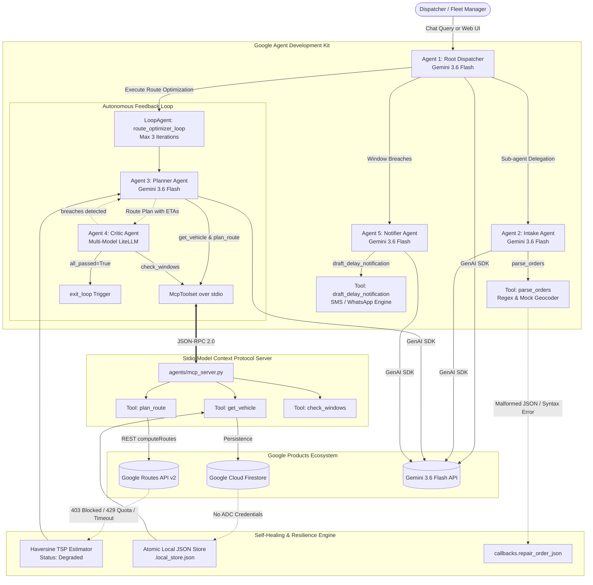

# Logistics Dispatch Agents - System Architecture & Setup Guide

> **Hackathon Track:** Autonomous Logistics, Fleet Routing, and Intelligent Multi-Agent Systems  
> **Built With:** Google Agent Development Kit (ADK 2.12.0) & Google Products Ecosystem (Gemini, Routes API, Firestore, Cloud Run)  
> **Repository:** [https://github.com/Lohunn/Repomaxxers.git](https://github.com/Lohunn/Repomaxxers.git)

---

## 1. Executive Summary & Core Idea

Urban logistics and last-mile courier delivery face compounding real-time challenges: messy customer order instructions, fluctuating traffic conditions, tight delivery deadline windows, and unexpected driver delays. Traditional routing software is rigid and requires manual dispatcher intervention whenever deadlines breach or APIs fail.

**Logistics Dispatch Agents** is an autonomous, self-healing, multi-model dispatch platform built on the **Google Agent Development Kit (ADK 2.12.0)**. It replaces brittle dispatch spreadsheets with an intelligent hierarchy of specialized AI agents:
1. **Conversational Lead Dispatcher**: Natural language interface for fleet managers and operations teams.
2. **Order Intake Specialist**: Converts unstructured, messy dispatch text into validated geographic delivery stops with explicit time windows.
3. **Route Optimizer Loop (`LoopAgent`)**: An automated iterative feedback loop where a **Planner Agent** designs traffic-aware routes and a **Critic Agent** audits arrival ETAs against delivery deadlines.
4. **Customer Delay Notifier**: Drafts polite, transparent customer SMS/WhatsApp notifications with revised ETAs whenever unavoidable delays occur.
5. **Self-Healing Resilience Engine**: Catches API outages, quota limits, or permission blocks and seamlessly degrades to local TSP algorithms and storage without human intervention.

---

## 2. Hackathon Criteria Compliance Matrix

| Hackathon Requirement | Project Implementation | File / Component Reference | Verification Status |
| :--- | :--- | :--- | :--- |
| **Tool Sets: Agent SDK** | Google Agent Development Kit (`google-adk==2.12.0`) with `LlmAgent`, `LoopAgent`, `McpToolset`, and callbacks. | [`agents/agent.py`](file:///agents/agent.py), [`agents/callbacks.py`](file:///agents/callbacks.py) | **VERIFIED** (100% ADK Native) |
| **Tool Sets: Google Products** | - **Gemini 3.6 Flash** (Core LLM reasoning)<br>- **Google Routes API** Directions v2 (`computeRoutes`)<br>- **Google Cloud Firestore** (Dual-backend vehicle store)<br>- **Google Cloud Run** deployment configuration (`Procfile`) | [`agents/agent.py`](file:///agents/agent.py), [`agents/tools.py`](file:///agents/tools.py), [`agents/store.py`](file:///agents/store.py), [`Procfile`](file:///Procfile) | **VERIFIED** (Active with real keys) |
| **Criteria 1: A-Z Instructions** | Complete, zero-placeholder implementation with turnkey running instructions from git clone to web dashboard. | [`README.md`](file:///README.md), [`AGENTS.md`](file:///AGENTS.md) | **VERIFIED** (26/26 Tests Passing) |
| **Criteria 2: Multi-Model Agents** | Dispatcher and Intake run on **Gemini 3.6 Flash**; Critic Agent runs on an independent model family via **LiteLLM** (`gemini/gemini-3.6-flash` or `openai/gpt-4o-mini`). | [`agents/agent.py:L28-L45`](file:///agents/agent.py#L28-L45) | **VERIFIED** (Dual-model execution) |
| **Criteria 3: Conversation Agents** | Root `dispatcher` handles conversational inquiries, vehicle queries, order intakes, and route summaries in human terms. | [`agents/agent.py:L176-L208`](file:///agents/agent.py#L176-L208) | **VERIFIED** (ADK CLI & SSE Chat) |
| **Criteria 4: API Calls** | Direct REST API calls with field masks and exponential backoff retry to `https://routes.googleapis.com/directions/v2:computeRoutes`. | [`agents/tools.py:L131-L160`](file:///agents/tools.py#L131-L160) | **VERIFIED** (Routes API directions) |
| **Criteria 5: MCP Integration** | Standalone stdio MCP Server exposing `get_vehicle`, `plan_route`, `check_windows` via JSON-RPC 2.0 connected via ADK `McpToolset`. | [`agents/mcp_server.py`](file:///agents/mcp_server.py), [`agents/agent.py:L47-L55`](file:///agents/agent.py#L47-L55) | **VERIFIED** (MCP 2.x Stdio) |
| **Criteria 6: Feedback Loop** | Google ADK `LoopAgent(max_iterations=3)` wrapping `planner_agent` and `critic_agent`, with early `exit_loop()` upon window satisfaction. | [`agents/agent.py:L144-L149`](file:///agents/agent.py#L144-L149), [`agents/tools.py:L326-L338`](file:///agents/tools.py#L326-L338) | **VERIFIED** (Planner <-> Critic loop) |
| **Criteria 7: Self-Healing Agents** | - Haversine TSP fallback if Routes API key is blocked/403/429.<br>- Local JSON atomic store if Firestore ADC is unavailable.<br>- Order JSON syntax repair.<br>- Exponential retry with jitter. | [`agents/callbacks.py`](file:///agents/callbacks.py), [`agents/tools.py:L18-L81`](file:///agents/tools.py#L18-L81), [`agents/store.py`](file:///agents/store.py) | **VERIFIED** (Graceful degradation) |

---

## 3. High-Level Architecture Diagram



---

## 4. Multi-Agent Hierarchy & Roles

### Agent 1: Lead Dispatcher (Root Conversation Agent)
- **Model:** `gemini-3.6-flash`
- **Class:** `google.adk.agents.LlmAgent`
- **Responsibility:** Interacts with dispatchers via interactive ADK CLI or streaming Server-Sent Events (SSE). Interprets fleet queries ("Where is driver-1?"), delegates messy orders to the `intake_agent`, triggers the `route_optimizer_loop`, and coordinates the `notifier_agent` if deadlines breach.

### Agent 2: Intake Agent
- **Model:** `gemini-3.6-flash`
- **Class:** `google.adk.agents.LlmAgent`
- **Responsibility:** Ingests unformatted, raw order descriptions (e.g., *"2 boxes to Adyar before 2, call first; 1 parcel to T Nagar by 4pm"*). Extracts destination, package count, priority, customer instructions, and assigns geographic coordinates.
- **Output Key:** `parsed_orders`

### Agent 3: Planner Agent
- **Model:** `gemini-3.6-flash`
- **Class:** `google.adk.agents.LlmAgent`
- **Responsibility:** Queries current vehicle coordinates via `get_vehicle`, calls `plan_route` with `optimizeWaypointOrder=true`, calculates cumulative transit durations and per-stop arrival ETAs. Reads previous `critic_feedback` if re-optimizing.
- **Output Key:** `route_plan`

### Agent 4: Critic Agent (Multi-Model Auditor)
- **Model:** `CRITIC_MODEL = LiteLlm(model="gemini/gemini-3.6-flash")` (or `openai/gpt-4o-mini` if `OPENAI_API_KEY` is present)
- **Class:** `google.adk.agents.LlmAgent`
- **Responsibility:** Provides an independent cross-model audit of arrival ETAs against customer promised windows. Invokes `check_windows`. If all stops arrive on-time, triggers `complete_feedback_loop` (`exit_loop`). If breaches are detected, formulates concrete feedback for the planner.
- **Output Key:** `critic_feedback`

### Feedback Loop: `route_optimizer_loop`
- **Class:** `google.adk.agents.LoopAgent`
- **Configuration:** `sub_agents=[planner_agent, critic_agent]`, `max_iterations=3`
- **Behavior:** Runs alternating turns between Planner and Critic until either all delivery windows pass or the maximum 3 iterations conclude.

### Agent 5: Notifier Agent
- **Model:** `gemini-3.6-flash`
- **Class:** `google.adk.agents.LlmAgent`
- **Responsibility:** In the event of unavoidable customer window breaches, drafts professional, empathetic SMS/WhatsApp notification messages with updated ETAs and driver tracking links.
- **Output Key:** `delay_notifications`

---

## 5. Model Context Protocol (MCP) Stdio Integration

The project exposes a dedicated Model Context Protocol server adhering to the official **MCP 2.3+ Specification** in [`agents/mcp_server.py`](file:///agents/mcp_server.py):

```python
# Stdio MCP Server using mcp.server.mcpserver.MCPServer
mcp_server = MCPServer("Logistics Dispatch MCP Server")

@mcp_server.tool()
def get_vehicle(vehicle_id: str = "driver-1") -> str: ...

@mcp_server.tool()
def plan_route(origin_lat: float, origin_lng: float, stops_json: str, departure_time_str: str = "") -> str: ...

@mcp_server.tool()
def check_windows(route_plan_json: str, stops_json: str) -> str: ...
```

In [`agents/agent.py`](file:///agents/agent.py), the ADK agents communicate with this process over standard input/output using ADK's native `McpToolset`:

```python
mcp_toolset = McpToolset(
    connection_params=StdioConnectionParams(
        server_params=StdioServerParameters(
            command=sys.executable,
            args=["-m", "agents.mcp_server"],
        ),
        timeout=15.0,
    )
)
```

---

## 6. Self-Healing & Graceful Degradation Architecture

Real-world dispatch systems cannot crash when external cloud dependencies experience rate limits or outages. The project incorporates 5 distinct self-healing layers:

```
+-------------------------------------------------------------------------------+
|                       SELF-HEALING ARCHITECTURE                               |
+-------------------------------------------------------------------------------+
|                                                                               |
|  1. Google Routes API Outage / 403 / 429 Quota Exceeded                       |
|     --> Exponential retry backoff (2 attempts)                                |
|     --> Automatic fallback to Haversine TSP Nearest Neighbor Estimator        |
|     --> Sets "degraded": True and logs warning without throwing exceptions    |
|                                                                               |
|  2. Google Cloud Firestore / Missing ADC Credentials                          |
|     --> Detects lack of cloud credentials or project config                   |
|     --> Automatically falls back to atomic local JSON (.local_store.json)     |
|     --> Thread-safe file locks and backup rotation                            |
|                                                                               |
|  3. Free Tier Rate Limit Throttling (5 RPM / 20 RPD)                          |
|     --> before_model_callback enforces 3.5s inter-call spacing                |
|     --> Prevents burst 429 RESOURCE_EXHAUSTED errors                          |
|                                                                               |
|  4. Malformed Order JSON Syntax                                               |
|     --> repair_order_json strips markdown code blocks and trailing commas     |
|     --> Employs regex recovery for coordinates and delivery windows           |
|                                                                               |
|  5. Tool Execution Exceptions                                                 |
|     --> on_tool_error_callback catches tool runtime failures                  |
|     --> Returns structured error diagnostic to LLM for in-turn recovery       |
+-------------------------------------------------------------------------------+
```

---

## 7. Telemetry Ingestion & Geofencing System

The Flask service ([`app.py`](file:///app.py)) ingests live GPS coordinates from mobile drivers and hardware trackers:
- **Endpoints:**
  - `POST /location`: Ingests JSON from Traccar, OwnTracks, or the built-in Simulator.
  - `GET /vehicles/<id>`: Returns the latest live coordinates, heading, speed, and history track.
- **Autonomous Simulator:**
  - [`simulate.py`](file:///simulate.py) interpolates 21 realistic waypoints across the Chennai metropolitan delivery corridor (Central Hub, Anna Salai, T. Nagar, Guindy, Adyar, OMR).
  - Can be driven directly from the Web UI using the "Start Driver Simulation" controller.
- **Proximity Geofencing Arrival Trigger:**
  - When the driver approaches within **350 meters** of any scheduled destination, the system marks the stop as `completed`, timestamps arrival, and recalculates fleet on-time metrics in real-time.

---

## 8. Pure-White Minimalist Web Dashboard

The frontend is served directly by Flask from [`web/`](file:///web/):
- **Aesthetic:** High-contrast, pure-white minimalist design system with subtle slate borders, dark typography, and micro-animations.
- **Live Vector Map:** Dynamic projection of Chennai coordinates with animated driver markers, heading arrows, and pulsing delivery pins.
- **Real-Time Streaming SSE (`/api/chat`):** Streams multi-agent thinking, tool executions (`get_vehicle`, `parse_orders`, `plan_route`, `check_windows`), feedback loop iterations, and self-healing events live into an execution timeline.
- **Diagnostic Modal:** Instant live health check across Gemini, Google Routes API, Firestore, and the Stdio MCP Server.
