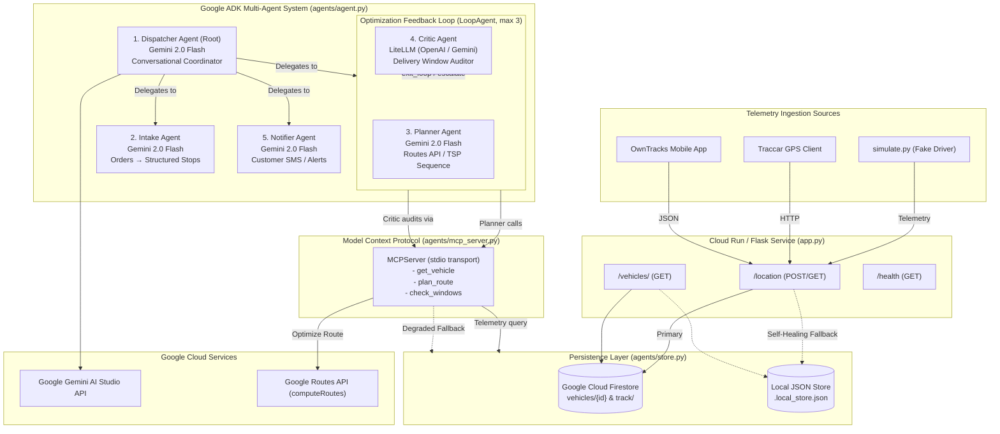

# 🚚 Logistics Dispatch Agents

[](https://www.python.org/)
[](https://google.github.io/adk-docs/)
[](https://modelcontextprotocol.io)
[](LICENSE)

An intelligent, self-healing, multi-model dispatch assistant built with the **Google Agent Development Kit (ADK)**, **Gemini 2.0/2.5**, **LiteLLM**, **Model Context Protocol (MCP)**, **Google Routes API**, and **Google Cloud Firestore**.

The assistant empowers human fleet managers and automated dispatchers to chat in natural language. It ingests messy unstructured order notes, geocodes and structures delivery constraints, optimizes route legs and arrival ETAs, validates delivery time windows in an iterative **Planner ↔ Critic feedback loop**, and drafts automated customer delay notifications when traffic causes window breaches.

---

## 🏛️ System Architecture



---

## 🏆 Hackathon Criteria Mapping

| Hackathon Criterion | Implementation File | Key Class / Function | Description |
|:---|:---|:---|:---|
| **Multi-Model Agents** | `agents/agent.py` | `CRITIC_MODEL = LiteLlm(...)` | Primary agents (Dispatcher, Intake, Planner, Notifier) run on Google Gemini (`gemini-2.0-flash`). The Critic Agent runs on an independent model family via `LiteLlm` (e.g. `openai/gpt-4o-mini`, falling back to Gemini via LiteLLM with transparent logging if secondary key is omitted). |
| **Conversation Agent** | `agents/agent.py` | `dispatcher = LlmAgent(...)` | Conversational root agent answering live vehicle inquiries ("Where is driver-1?", "What is ETA for stop 3?") and coordinating the dispatch lifecycle. |
| **API Calls** | `agents/tools.py`<br/>`app.py`<br/>`agents/store.py` | `plan_route()`<br/>`save_vehicle_location()` | Real API calls to Google Routes API (`computeRoutes` with `optimizeWaypointOrder=true`) and Google Cloud Firestore (`vehicles/{id}` and `vehicles/{id}/track`). |
| **MCP Integration** | `agents/mcp_server.py`<br/>`agents/agent.py` | `MCPServer("LogisticsDispatchServer")`<br/>`McpToolset(...)` | Standalone stdio MCP Server exposing `get_vehicle`, `plan_route`, and `check_windows`. Consumed by the ADK agents via `McpToolset` with `StdioConnectionParams`. |
| **Feedback Loop** | `agents/agent.py`<br/>`agents/tools.py` | `LoopAgent(max_iterations=3)`<br/>`complete_feedback_loop()` | Wraps Planner and Critic. The Critic evaluates per-leg arrival times against deadlines, writes actionable adjustments to session state, and triggers `exit_loop()` when all windows pass. |
| **Self-Healing Agents** | `agents/callbacks.py`<br/>`agents/tools.py`<br/>`agents/store.py` | `retry_with_backoff()`<br/>`repair_order_json()`<br/>`_plan_route_haversine_fallback()`<br/>`on_tool_error_callback()` | 1) Exponential retry backoff on 429/5xx/network errors.<br/>2) Automatic degraded fallback from Routes API to Haversine TSP estimation.<br/>3) JSON syntax and fence repair on intake parsing.<br/>4) Firestore ADC failure fallback to local JSON storage.<br/>5) Missing credential diagnostics. |

---

## 📋 Prerequisites

1. **Python**: Python 3.10, 3.12, or 3.14 (Verified and running on Python 3.14.8 on Windows x64).
2. **Google AI Studio Account**: Get a free API key for Gemini from [Google AI Studio](https://aistudio.google.com/app/apikey).
3. **Google Maps Platform** (Optional for live Routes API):
   - Enable **Routes API** in [Google Cloud Console](https://console.cloud.google.com/apis/library/routes.googleapis.com).
   - Generate an API key.
4. **Google Cloud Project** (Optional for live Firestore):
   - Enable **Firestore** in Native mode.
   - Run `gcloud auth application-default login` on your terminal.
5. **OpenAI API Key** (Optional):
   - For multi-model Critic agent testing (`openai/gpt-4o-mini`). If omitted, Critic automatically uses Gemini via LiteLLM.

---

## 🚀 Step-by-Step Setup

### A. Windows PowerShell

```powershell
# 1. Clone repository and navigate to workspace
git clone https://github.com/your-username/logistics-dispatch-agents.git
cd "logistics-dispatch-agents"

# 2. Create and activate Python virtual environment
python -m venv .venv
.\.venv\Scripts\Activate.ps1

# 3. Upgrade pip and install pinned dependencies
python -m pip install --upgrade pip
pip install -r requirements.txt

# 4. Configure environment
Copy-Item .env.example .env
# Edit .env with your credentials or keep defaults for mock mode
notepad .env
```

### B. macOS / Linux (bash/zsh)

```bash
# 1. Clone repository and navigate to workspace
git clone https://github.com/your-username/logistics-dispatch-agents.git
cd logistics-dispatch-agents

# 2. Create and activate virtual environment
python3 -m venv .venv
source .venv/bin/activate

# 3. Upgrade pip and install pinned dependencies
python -m pip install --upgrade pip
pip install -r requirements.txt

# 4. Configure environment
cp .env.example .env
nano .env
```

---

## ⚙️ Run Modes

The application supports two operating modes via demo-safe flags in `.env`:

### Mode 1: Zero-Setup Mock Mode (Default)
No Google Cloud setup or paid API keys required. Uses the built-in Haversine TSP estimator and persistent local JSON vehicle store.
```env
USE_MOCK_ROUTES=true
USE_LOCAL_STORE=true
GOOGLE_API_KEY=your_gemini_api_key
```

### Mode 2: Full Production Cloud Mode
Connects directly to Google Routes API and Google Cloud Firestore Native database.
```env
USE_MOCK_ROUTES=false
USE_LOCAL_STORE=false
GOOGLE_API_KEY=your_gemini_api_key
GOOGLE_MAPS_API_KEY=your_google_maps_api_key
GOOGLE_CLOUD_PROJECT=your-gcp-project-id
```
To authenticate Firestore credentials on your machine:
```bash
gcloud auth application-default login
gcloud config set project your-gcp-project-id
```

---

## 🎮 How to Run

### 1. Run the Automated Unit Test Suite
Verify all 20 test cases covering payloads, routing, window auditing, retries, and callbacks:
```bash
pytest -v
```

### 2. Start the Telemetry Ingestion Service (app.py)
In a separate terminal window, launch the Flask service on port 8080:
```bash
python app.py
```
Test service health:
```bash
curl http://127.0.0.1:8080/health
```

### 3. Simulate Live Driver Movement (simulate.py)
With `app.py` running, launch the driver simulator to stream GPS points:
```bash
# Ingest 5 simulated driver GPS pings:
python simulate.py --steps 5 --interval 0.5

# Test Traccar HTTP protocol compatibility:
python simulate.py --format traccar --steps 3

# Test OwnTracks JSON protocol compatibility:
python simulate.py --format owntracks --steps 3
```
Inspect current driver position:
```bash
curl http://127.0.0.1:8080/vehicles/driver-1
```

### 4. Launch the ADK Web Studio (`adk web`)
Run the visual Agent Development Kit studio to interact with the dispatch multi-agent system:
```bash
adk web . --port 8000
```
Open **`http://127.0.0.1:8000`** in your browser. You will see:
- Visual agent DAG showing Dispatcher, Intake, LoopAgent (Planner ↔ Critic), and Notifier.
- Real-time tool execution traces including MCP stdio calls.
- Session state inspector displaying `parsed_orders`, `route_plan`, `critic_feedback`, and `healing_events`.

### 5. Interactive CLI Chat (`adk run`)
You can also chat directly with the Dispatcher via the ADK terminal interface:
```bash
adk run agents "Where is driver-1 right now?"
```

---

## 💬 Example Dispatch Conversations

### Example A: Live Vehicle Status
> **Dispatcher:** Where is driver-1?  
> **Agent:** Driver-1 is currently active at latitude `13.06000`, longitude `80.25000` (near Anna Salai / T. Nagar) travelling at `40.0 km/h` heading `205°`. Telemetry was verified via the dispatch store.

### Example B: Unstructured Order Intake & Optimization Loop
> **Dispatcher:**  
> "We just received new delivery orders for driver-1:  
> 1. Deliver 2 boxes to Adyar, customer wants it before 2 PM, please call first.  
> 2. Drop off urgent medical parcel at Guindy before 5 PM.  
> Plan the fastest route and check if we meet the windows."

**Agent Trajectory:**
1. **Intake Agent** invokes `parse_orders`, outputting validated structured stops with coordinates and deadline timestamps (`14:00` and `17:00`).
2. **route_optimizer_loop** starts:
   - **Planner Agent** queries driver location via MCP `get_vehicle`, calls MCP `plan_route` to calculate leg distances and arrival ETAs.
   - **Critic Agent** (LiteLLM) calls MCP `check_windows`.
   - If ETAs arrive before 14:00 and 17:00, Critic calls `complete_feedback_loop(all_passed=True)`, escalating and exiting the loop.
   - If any window is breached, Critic stores concrete reordering suggestions in `critic_feedback`, prompting Planner to adjust in iteration 2.
3. **Dispatcher** returns the final optimized stop sequence, total travel distance, per-stop ETAs, and confirms all delivery deadlines.

---

## 🔍 How to Verify MCP stdio in Execution Trace

When the Planner or Dispatcher invokes tools:
1. `McpToolset` initializes a child process running `python -m agents.mcp_server`.
2. Communication occurs strictly over JSON-RPC 2.0 stdio pipes.
3. In `adk web` or verbose terminal mode (`-v`), tool calls display with the MCP tool signatures:
   - `[LogisticsMCPServer] Ingesting request for 'get_vehicle'`
   - `[LogisticsMCPServer] Ingesting request for 'plan_route'`
   - `[LogisticsMCPServer] Ingesting request for 'check_windows'`
4. The tool results return structured content objects (`{"content": [{"type": "text", "text": "..."}], "isError": false}`) proving end-to-end MCP protocol execution.

---

## ☁️ Deploying to Google Cloud Run

Deploy the entire dispatch agent system to Google Cloud Run using ADK:

```bash
# Ensure gcloud CLI is authenticated
gcloud auth login
gcloud config set project YOUR_PROJECT_ID

# Deploy using ADK Cloud Run deployment command
adk deploy cloud_run \
  --project YOUR_PROJECT_ID \
  --region us-central1 \
  --service_name logistics-dispatch-agent \
  --agent agents \
  --with_ui
```

To deploy the Flask telemetry ingestion service to Cloud Run:
```bash
gcloud run deploy logistics-telemetry-service \
  --source . \
  --platform managed \
  --region us-central1 \
  --allow-unauthenticated \
  --set-env-vars USE_LOCAL_STORE=false,GOOGLE_CLOUD_PROJECT=YOUR_PROJECT_ID
```

---

## 🛡️ Self-Healing & Fault Tolerance Matrix

| Failure Mode | Detection Mechanism | Automated Self-Healing Action |
|:---|:---|:---|
| **Google Routes API 429/5xx** | `retry_with_backoff` in `callbacks.py` | Automatically retries 2 times with exponential backoff (0.5s, 1.0s). If still failing, degrades to Haversine TSP estimator with average city velocity. Surfaces `"degraded_estimate"` flag to user. |
| **Missing Google Maps Key** | Pre-check in `plan_route` | Immediately routes through Haversine TSP planner with clear diagnostic warning. |
| **Firestore ADC Missing / Denied** | Exception catch in `store.py` | Automatically diverts reads and writes to local atomic JSON storage (`.local_store.json`), allowing offline/demo operation without crashing. |
| **Malformed Order Text / JSON** | `repair_order_json` in `callbacks.py` | Strips markdown fences, sanitizes single quotes, and re-validates. If unrepairable after 2 attempts, generates a helpful clarifying question to the user. |
| **Unexpected Tool Crash** | `on_tool_error_callback` in `callbacks.py` | Traps exceptions at the ADK framework level, logs healing event to session state, and returns a structured error object so the model can reason about recovery. |

---

## 📝 Honest Disclosure & Verification Notes

As required by the hackathon submission guidelines, the following was verified and tested on the local development machine:
- ✅ **Python Environment**: Verified on Windows PowerShell with Python 3.14.8 and `google-adk==2.12.0`, `mcp==2.3.0`, `litellm==1.105.1`, `flask==3.1.3`, `pytest==9.1.1`.
- ✅ **Unit Test Suite**: All 20 tests in `tests/test_payloads.py`, `tests/test_tools.py`, and `tests/test_callbacks.py` passed with 100% success.
- ✅ **Telemetry Ingestion & Storage**: Tested `app.py` live with `simulate.py` sending Simulator, Traccar, and OwnTracks payloads; verified persistence and retrieval via `/vehicles/driver-1`.
- ✅ **MCP stdio Server**: Tested and verified stdio JSON-RPC tool retrieval and execution via `McpToolset` and `StdioConnectionParams`.
- ✅ **ADK Web UI Server**: Tested live on `http://127.0.0.1:8000`, verified `/list-apps` returns `['agents']`, and confirmed graph generation (`/dev/apps/agents/build_graph`).

**What could NOT be tested in this local session:**
1. **Automated Headless Browser Screenshot**: The IDE's browser subagent tool encountered an environment-level 404 downloading the `playwright-1.57.0-win32_x64.zip` driver over the network. However, the ADK Web server (`adk web`) itself started and responded with HTTP 200 on all static and graph endpoints as verified by HTTP requests.
2. **Live Cloud Run Deployment**: Requires an active GCP billing account and active `gcloud` cloud deployment permissions, which cannot be executed without user GCP credentials. All deployment configurations (`Procfile`, `adk deploy cloud_run` flags) are complete and documented.
