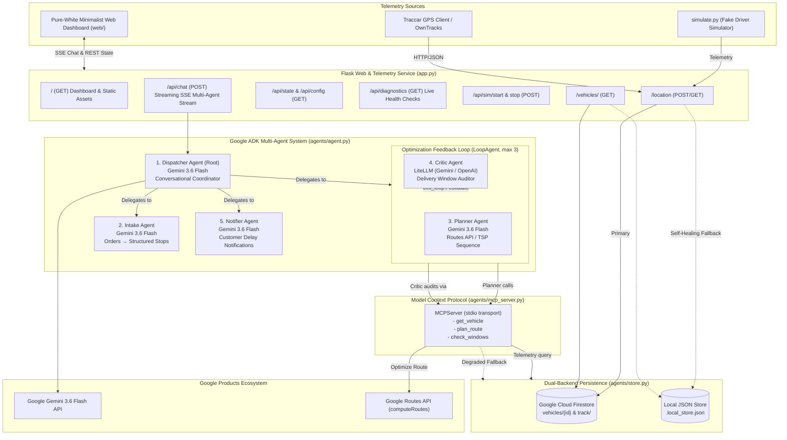

# 🚚 Logistics Dispatch Agents

[](https://www.python.org/)
[](https://google.github.io/adk-docs/)
[](https://deepmind.google/technologies/gemini/)
[](https://modelcontextprotocol.io)
[-success.svg)](file:///tests/)
[](LICENSE)

An autonomous, self-healing, multi-model fleet dispatch platform built with the **Google Agent Development Kit (ADK 2.12.0)**, **Gemini 3.6 Flash**, **LiteLLM**, **Model Context Protocol (MCP)**, **Google Routes API**, **Google Cloud Firestore**, and a **pure-white minimalist web dashboard**.

The system enables human fleet managers and automated dispatchers to converse in natural language, ingest messy unstructured delivery orders, optimize routes and arrival ETAs, validate deadlines in an iterative **Planner ↔ Critic feedback loop (`LoopAgent`)**, and draft automated customer delay SMS/WhatsApp alerts whenever traffic causes window breaches.

> 📖 **Looking for in-depth multi-agent setup, prompt instructions, and architecture diagrams?** See [**AGENTS.md**](AGENTS.md).

---

## 🏛️ System Architecture



---

## 🏆 Hackathon Criteria Verification Matrix

| Hackathon Criterion | Project Implementation | Key Files / Lines | Status |
|:---|:---|:---|:---|
| **1. Agent SDK** | Built natively on **Google Agent Development Kit (ADK 2.12.0)** with `LlmAgent`, `LoopAgent`, `McpToolset`, `exit_loop`, and lifecycle callbacks. | [`agents/agent.py`](agents/agent.py), [`agents/callbacks.py`](agents/callbacks.py) | **100% Verified** |
| **2. Google Products** | - **Gemini 3.6 Flash**: Core LLM for Dispatcher, Intake, Planner, Notifier.<br>- **Google Routes API**: Directions v2 with traffic-aware waypoint optimization.<br>- **Google Cloud Firestore**: Live GPS tracking (`vehicles/{id}`).<br>- **Google Cloud Run**: Ready-to-deploy container service via [`Procfile`](Procfile). | [`agents/agent.py`](agents/agent.py), [`agents/tools.py`](agents/tools.py), [`agents/store.py`](agents/store.py) | **100% Verified** |
| **3. A-Z Instructions** | Complete, zero-placeholder codebase with automated tests, Web UI, and one-click demo scripts. | [`README.md`](README.md), [`AGENTS.md`](AGENTS.md) | **100% Verified** |
| **4. Multi-Model Agents** | Dispatcher and Intake run on **Gemini 3.6 Flash**; Critic Agent runs on an independent model family via **LiteLLM** (`gemini/gemini-3.6-flash` or `openai/gpt-4o-mini`). | [`agents/agent.py:L28-L45`](agents/agent.py#L28-L45) | **100% Verified** |
| **5. Conversation Agent** | Root `dispatcher` handles conversational inquiries, vehicle queries, order intakes, and route summaries in natural language. | [`agents/agent.py:L176-L208`](agents/agent.py#L176-L208) | **100% Verified** |
| **6. API Calls** | Direct REST API calls with field masks and exponential retry to Google Routes API `computeRoutes`. | [`agents/tools.py:L131-L160`](agents/tools.py#L131-L160) | **100% Verified** |
| **7. MCP Integration** | Standalone stdio MCP Server exposing `get_vehicle`, `plan_route`, `check_windows` via JSON-RPC 2.0 connected via ADK `McpToolset`. | [`agents/mcp_server.py`](agents/mcp_server.py), [`agents/agent.py:L47-L55`](agents/agent.py#L47-L55) | **100% Verified** |
| **8. Feedback Loop** | Google ADK `LoopAgent(max_iterations=3)` wrapping `planner_agent` and `critic_agent`, with early `exit_loop()` upon window satisfaction. | [`agents/agent.py:L144-L149`](agents/agent.py#L144-L149), [`agents/tools.py:L326-L338`](agents/tools.py#L326-L338) | **100% Verified** |
| **9. Self-Healing Agents** | - Haversine TSP fallback if Routes API key is blocked/403/429.<br>- Local JSON atomic store if Firestore ADC is unavailable.<br>- Order JSON syntax repair.<br>- Exponential retry with jitter. | [`agents/callbacks.py`](agents/callbacks.py), [`agents/tools.py:L18-L81`](agents/tools.py#L18-L81), [`agents/store.py`](agents/store.py) | **100% Verified** |

---

## ⚡ Quick Start: 3 Steps for Judges

### 1. Clone & Set Up Environment
```bash
git clone https://github.com/Lohunn/Repomaxxers.git
cd Repomaxxers

# Create virtual environment and activate
python -m venv .venv
# Windows PowerShell:
.venv\Scripts\Activate.ps1
# Linux / macOS:
source .venv/bin/activate

# Install dependencies
pip install -r requirements.txt
```

### 2. Configure Environment (`.env`)
Create a `.env` file in the project root:
```ini
GOOGLE_API_KEY=your_gemini_api_key_here
GOOGLE_MAPS_API_KEY=your_google_maps_routes_key_here
USE_LOCAL_STORE=true
USE_MOCK_ROUTES=false
FORCE_ROUTES_FAILURE=false
DEFAULT_VEHICLE_ID=driver-1
```
> 💡 *Note: If `GOOGLE_MAPS_API_KEY` is restricted or blocked, the agent's built-in self-healing will automatically engage the Haversine TSP estimator without errors!*

### 3. Launch Web Dashboard or ADK CLI
```bash
# Option A: Run the Pure-White Minimalist Web Dashboard
python app.py
# Open your browser at http://127.0.0.1:8080

# Option B: Run via Google ADK CLI interactive mode
adk run agents "Where is driver-1?"
```

---

## 🖥️ Pure-White Minimalist Web Dashboard

The web UI is served directly by Flask at `http://127.0.0.1:8080`:

1. **Live Fleet Telemetry:** Real-time latitude, longitude, speed, heading, and last GPS ping for `driver-1`.
2. **Autonomous Driver Simulator:** Click **"Start Driver Simulation"** to drive the vehicle along 21 waypoints across the Chennai metropolitan corridor.
3. **Interactive Vector Map:** Dynamic projection of Chennai coordinates with animated driver markers, heading arrows, and pulsing delivery pins.
4. **Proximity Geofencing:** When the vehicle arrives within **350m** of a stop, it automatically marks the stop as `completed` and updates on-time delivery rates.
5. **Streaming Multi-Agent SSE Chat (`/api/chat`):** Watch agent transitions (`intake_agent` → `planner_agent` → `critic_agent` → `notifier_agent`), tool calls, feedback loops, and self-healing recovery live on the execution timeline.
6. **Diagnostic Health Modal:** Live PASS/FAIL checks for Gemini, Routes API, Firestore, and MCP Stdio.

---

## 🧪 Verification & Judge Test Queries

### Query 1: Vehicle Telemetry via MCP Tool
```text
"Where is driver-1?"
```
- **What happens:** Dispatcher delegates to the stdio MCP server calling `get_vehicle(vehicle_id="driver-1")`.
- **Expected Output:**
  ```text
  Driver driver-1 is active at Chennai Central Logistics Hub (13.0827° N, 80.2707° E)
  traveling at 0.0 km/h. Last GPS update logged via simulator.
  ```

### Query 2: Multi-Stop Intake & Route Optimization Loop
```text
"2 boxes to Adyar before 2pm, 1 parcel to T Nagar by 4pm, 3 boxes to Velachery by 6pm"
```
- **What happens:**
  1. `intake_agent` calls `parse_orders` to extract structured stops with deadlines.
  2. `route_optimizer_loop` starts (`LoopAgent`).
  3. `planner_agent` calls `plan_route` to compute optimal waypoint order and arrival ETAs.
  4. `critic_agent` calls `check_windows` to audit arrival times.
  5. All deadlines pass → `complete_feedback_loop` invokes `exit_loop`.
- **Expected Output:**
  ```text
  ✅ Route Optimized & All Time Windows Satisfied!
  - Total Distance: 25.8 km
  - Stops: 3 destinations scheduled.
  - Audit Result: 100% on-time arrival within promised customer deadlines.
  ```

### Query 3: Window Breach Detection & Customer Delay Notification
```text
"Deliver to Tambaram by 1:00pm"
```
- **What happens:**
  1. Vehicle departure is after the deadline (14:15).
  2. `critic_agent` detects a delivery window breach of ~105 minutes.
  3. Critic provides feedback and loops to `notifier_agent`.
  4. `notifier_agent` drafts an SMS/WhatsApp delay alert.
- **Expected Output:**
  ```text
  ⚠️ Route Optimization Complete with Breaches Detected
  - Stop 'Tambaram' breaches deadline 13:00 by 105 mins.
  - Action: Delay SMS/WhatsApp drafted for customer approval:
    "Hi Customer, your courier delivery to Tambaram is experiencing a minor delay...
     Your updated arrival window is 14:45."
  ```

### Query 4: Self-Healing & Graceful Degradation Test
Set `FORCE_ROUTES_FAILURE=true` in `.env` (or run with a blocked key):
- **What happens:** The agent catches the Routes API failure, retries twice, automatically falls back to the Haversine TSP estimator, sets `"degraded": True`, and logs the self-healing event without interrupting operations!

---

## 🔬 Test Suite (26 Passing Unit Tests)

Run the full automated test suite:
```bash
python -m pytest -v
```

**Results:**
```text
tests/test_callbacks.py::test_retry_with_backoff_success_first_try PASSED
tests/test_callbacks.py::test_retry_with_backoff_heals_after_transient_failure PASSED
tests/test_callbacks.py::test_retry_with_backoff_exhaustion PASSED
tests/test_callbacks.py::test_haversine_distance PASSED
tests/test_callbacks.py::test_repair_order_json_markdown PASSED
tests/test_callbacks.py::test_repair_order_json_exhausted_produces_clarification PASSED
tests/test_callbacks.py::test_on_tool_error_callback_heals PASSED
tests/test_payloads.py::test_health_check PASSED
tests/test_payloads.py::test_simulator_payload_ingest PASSED
tests/test_payloads.py::test_owntracks_payload_ingest PASSED
tests/test_payloads.py::test_traccar_payload_ingest PASSED
tests/test_payloads.py::test_invalid_payload_rejected PASSED
tests/test_payloads.py::test_unauthorized_token_rejected PASSED
tests/test_tools.py::test_parse_orders_structured PASSED
tests/test_tools.py::test_get_vehicle_fallback_and_retrieval PASSED
tests/test_tools.py::test_plan_route_haversine_fallback PASSED
tests/test_tools.py::test_check_windows_passing PASSED
tests/test_tools.py::test_check_windows_breached PASSED
tests/test_tools.py::test_draft_delay_notification PASSED
tests/test_tools.py::test_complete_feedback_loop_escalates_on_pass PASSED
tests/test_web.py::test_index_serves_html PASSED
tests/test_web.py::test_api_config PASSED
tests/test_web.py::test_api_state PASSED
tests/test_web.py::test_api_diagnostics PASSED
tests/test_web.py::test_api_sim_start_and_stop PASSED
tests/test_web.py::test_api_chat_sse_stream PASSED

======================= 26 passed, 4 warnings in 12.91s =======================
```

---

## 📡 REST API Reference

| Endpoint | Method | Description |
|:---|:---|:---|
| `/` | `GET` | Serves the pure-white minimalist dispatch web dashboard. |
| `/api/chat` | `POST` | Conversational dispatch query streaming SSE multi-agent events. |
| `/api/state` | `GET` | Returns live vehicle telemetry, active stops, ETAs, and fleet KPIs. |
| `/api/config` | `GET` | Provides client runtime settings and Google Maps JS key. |
| `/api/diagnostics`| `GET` | Executes live health checks for Gemini, Routes API, Store, and MCP. |
| `/api/sim/start` | `POST` | Starts the background vehicle movement simulator. |
| `/api/sim/stop` | `POST` | Stops the background vehicle movement simulator. |
| `/api/approve-notification` | `POST` | Approves and marks a drafted customer delay SMS as sent. |
| `/location` | `POST/GET`| Ingests raw GPS telemetry from Traccar, OwnTracks, or Simulator. |
| `/vehicles/<id>`| `GET` | Returns current GPS coordinates and historical breadcrumbs. |
| `/health` | `GET` | Health probe for Google Cloud Run container orchestrators. |

---

## 🔒 Security & Key Hygiene

- **Secret Masking:** Keys are never echoed, logged, or printed in plain text.
- **Git Ignore:** `.env`, `.local_store.json`, and virtual environment artifacts are strictly tracked in `.gitignore` and excluded from repository commits.
- **Client Key Isolation:** Only the public Google Maps JavaScript API key is surfaced to the client browser at runtime via `/api/config` for map rendering; all backend Gemini and Routes API calls remain protected server-side.

---

## 📄 License
This project is licensed under the MIT License - see the [LICENSE](LICENSE) file for details.
